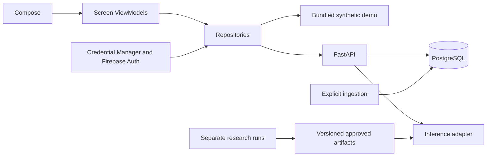
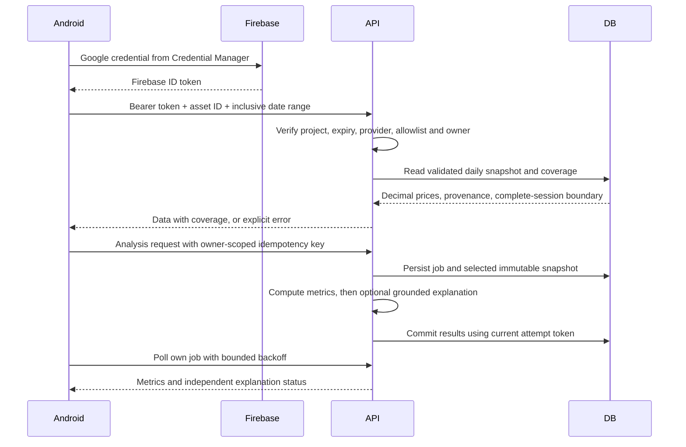

# StockApp architecture

**Implemented today.** Pulse runs in the Gradle `app` module using Kotlin, Compose and Material 3. `MainActivity` manages navigation and saveable demo state. Quotes and chart samples are bundled in `DemoMarket.kt`. Account actions are demo navigation.

**Approved direction.** Keep the single Android module and introduce screen ViewModels as real data arrives. A ViewModel exposes immutable `StateFlow<UiState>` and receives user actions. Composables collect lifecycle-aware state and keep transient presentation state local. Repositories coordinate bundled synthetic data, remote DTO mapping and owner-scoped caching. Clear private session-scoped state on sign-out. Keep credentials in the supported identity SDK. Represent loading, empty, partial, stale, forbidden and retryable states explicitly.

One future Python FastAPI service owns modules for identity, instruments and daily bars, analysis, and inference. SQLAlchemy owns persistence and Alembic owns schema migrations against PostgreSQL. HTTP handlers validate and authorize inputs before delegating. Place ingestion and research behind explicit CLI entry points. Run training and data ingestion separately from the HTTP process. Begin with one database and a bounded analysis loop with durable leases when jobs land.

Public demo endpoints use versioned synthetic fixtures. Personal endpoints require a Google sign-in and an allowlisted Firebase UID. External providers and inference APIs are server-side integrations. Scope the first product to date-range queries over US stocks and USD-denominated cryptocurrency. Analysis starts with deterministic metrics and adds a grounded explanation under an independent runtime status.

Read the [Android design](android.md), [backend design](backend.md), [architecture decisions](adr/README.md), [roadmap](../development/roadmap.md), [API](api-v1.yaml), [schema](data-model.md), [analysis design](ai-ml.md), and [Render runbook](../operations/render.md).

## Issue ownership

The [roadmap](../development/roadmap.md) maps each capability to its published GitHub issue and prerequisites.

| Capability | Implementing issues |
| --- | --- |
| Architecture, API, ADR and delivery process | [A01](../development/issues/A01.md), [A02](../development/issues/A02.md), [A03](../development/issues/A03.md), [A04](../development/issues/A04.md), [A05](../development/issues/A05.md) |
| Penpot persistence, editable design and controlled sync | [A06](../development/issues/A06.md), [A07](../development/issues/A07.md), [A08](../development/issues/A08.md), [A09](../development/issues/A09.md) |
| Backend, identity and Android state | [B01](../development/issues/B01.md), [B02](../development/issues/B02.md), [B03](../development/issues/B03.md), [B04](../development/issues/B04.md), [B05](../development/issues/B05.md), [B06](../development/issues/B06.md) |
| Data rights, catalog, ingestion, caching, charts and watchlists | [C01](../development/issues/C01.md), [C02](../development/issues/C02.md), [C03](../development/issues/C03.md), [C04](../development/issues/C04.md), [C05](../development/issues/C05.md), [C06](../development/issues/C06.md) |
| Metrics, explanation, jobs, research, promotion and inference | [D01](../development/issues/D01.md), [D02](../development/issues/D02.md), [D03](../development/issues/D03.md), [D04](../development/issues/D04.md), [D05](../development/issues/D05.md), [D06](../development/issues/D06.md) |
| Render operations, release, restore, rollback and observability | [A10](../development/issues/A10.md), [E01](../development/issues/E01.md), [E02](../development/issues/E02.md), [E03](../development/issues/E03.md), [E04](../development/issues/E04.md), [E05](../development/issues/E05.md) |
| Portfolio, alerts and release readiness | [F01](../development/issues/F01.md), [F02](../development/issues/F02.md), [F03](../development/issues/F03.md) |
